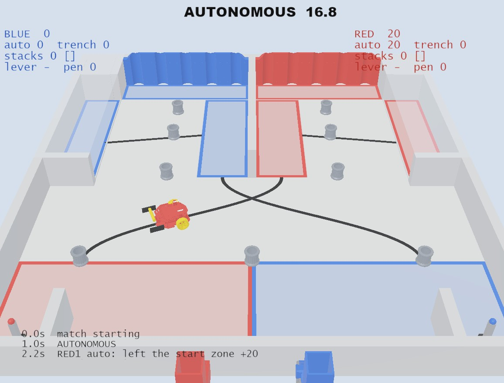

# Red Robot 2026 – Webots simulation

A Webots simulation of the Red Robot 2026 game built from the Onshape CAD: field,
pipe factories, pipes, and the **mainV2** kit robot. It runs your team's
**unchanged** `RR26_Arduino` code and gives you a match clock, scoring and RP.



What it's good for: tuning auto (line following, timing, the trench drop),
driver practice, and trying out match strategy. What it's *not* good for: deciding
whether a gripper will actually hold a pipe. The contact physics is approximate,
so prototype your intake in real life.

---

## 1. Setup (once)

1. Install **Webots R2025a** (free): <https://cyberbotics.com>
2. Install a C++ compiler:
   * **macOS:** `xcode-select --install`
   * **Linux:** `sudo apt install build-essential`
   * **Windows:** nothing to install. Webots ships its own MSYS2/gcc.
3. Python 3 must be on your PATH (the game supervisor is written in Python).
4. Open `worlds/red_robot_2026.wbt` in Webots.
5. The first time, build the robot controller. Do either one:
   * In Webots, **File → Open Text File…** → `controllers/red_robot/sim/sim_redrobot.cpp`,
     then click the **Build** (gear) button in the editor.
   * Or from a terminal: `cd controllers/red_robot && make`
     (requires `WEBOTS_HOME` to be set to your Webots install folder).
6. **Reload the world** (Ctrl/Cmd + Shift + R). The match starts automatically.

## 2. Use your team's code

`controllers/red_robot/team/` holds a copy of the RR26_Arduino repo:

```
team/RR26_Arduino.ino      <- your sketch (setup + AutonomousLoop)
team/RedRobot.h
team/CONFIGURE-ME.h
team/src/RemoteControl.cpp <- your controller callbacks
team/src/*.cpp             <- any other .cpp files you add are compiled too
```

To use your code, copy your repo's files over these, then **Build** and **reload**.
`src/RedRobot.cpp` and `src/ble.h` are ignored, because the simulator supplies its own
implementation of `RedRobot.h` (in `sim/`). If you rename your `.ino`, update
`sim/team_sketch.cpp`.

There's a working **line-following auto** in `examples/line_follow_auto/`. In the sim it
finds the tape, follows the curve to the safe zone, and earns both auto bonuses.
It's a good starting point for your real auto.

## 3. Driving (teleop)

Click the 3D view first so it has keyboard focus.

| Key | Controller input | Sample code does |
|---|---|---|
| **X** or **1** | X button | **starts remote control** (stops auto) |
| Y or 2 / 3 / B or 4 | Y / A / B | Y toggles tank drive |
| **W A S D** | left joystick | arcade drive |
| I J K L | right joystick | right side in tank mode |
| Arrow keys | D-pad | drive |
| Space | D-pad centre | |

A USB gamepad also works if Webots detects it. During **autonomous** the controller
is locked, the same as holding your controller in the air.

## 4. Match flow and scoring

The match runs as 1 s get-ready, **20 s auto**, **120 s teleop** (the last 20 s are end
game), then the buzzer. At the buzzer the sim pauses and the console prints a full
breakdown with RP. Reload the world to play again.

**Practice mode** has no clock and lets you drive immediately: select the
`game supervisor` node → `controllerArgs` → add `--practice`.

The game supervisor scores from object positions:

| | Rule used |
|---|---|
| Trench, 10 | The pipe is lying down and both ends of its centreline are inside the trench tape |
| Smokestack, 20/40/60 | The pipe is upright and overlaps a smokestack semicircle. The bottom pipe must be on the floor and fully inside the Steam Plant zone. Each pipe above must sit on the one below |
| Auto +20 | Robot ends up fully outside the start zone |
| Auto +20 | Robot gets within 15 cm of the **end of its alliance's line** (the "line follow" check is approximate) |
| Auto +10 | The alliance's first dispense-button press during auto |
| Auto +20 / pipe | Each pipe that is scored at the end of auto |
| Lever | The arm is tipped more than 35° during the end game (it's latched, so it stays counted) |
| −20 | Touching an opponent that is fully inside its safe zone. Detected from physics contacts, with a 3 s grace period |
| RP | Win 2 / tie 1; **auto RP** = all robots out of the start zone + 1 trench pipe in auto; **teleop RP** = lever + 2 smokestack pipes |

Not modeled: pinning (−50), sudden death, and the rule about holding 5 pipes at most.

**Pipe factories:** push the coloured button on the near wall. A pipe rolls out of the
factory into the field, with a 3 s cooldown. If the outlet is blocked, nothing comes out.

## 5. The robot model (`protos/RRRobot.proto`)

| API | Sim device | Notes |
|---|---|---|
| `WriteDCMotor(2/3, ±100)` | left/right drive wheels | ~250 rpm TT motor, 0.12 N·m, 6 % deadband |
| `WriteDCMotor(0, …)` | `motor0`, a placeholder front roller | **motor 1 is rejected**, same as the real board, because it shares a pin with the line-sensor LED |
| `SetServo(0..3, angle)` | servo0/1 = front claw paddles, servo2/3 = horns | Uses the firmware mapping: −180…180 → 500…2500 µs, so **`SetServo(0)` is servo centre** and 0…180 covers only half the travel |
| `ReadLineSensor(v)` | 6 downward IR sensors at the nose, 9.5 mm pitch | `v[0]` is the robot's **right** side. White floor ≈ 150, black tape ≈ 2500. The call takes ~10–20 ms of sim time, like the real RC read |

The CAD had only one wheel and no caster, so the model mirrors the wheel and adds a ball
caster under the nose. The STL was also **upside-down** (with z up, the motor cans would sit
below the wheels), so it is flipped. **Check both against the real robot.**

When your intake exists in CAD, export its STL, put it in `protos/meshes/`, and replace the
servo0/servo1 paddles in the PROTO with your mechanism. Use simple Box/Cylinder shapes for
`boundingObject`.

To log every motor command and key press to the console, set the environment variable
`RR_SIM_DEBUG=1` before launching Webots.

## 6. The field (`field_config.json`)

The walls, smokestacks, factories and pipe come from the Onshape CAD. Everything the CAD
doesn't contain is in **`field_config.json`**: tape lines, zones, button and lever spots,
the 9 starting pipes, match timings, and point values. These were measured off the
manual's field diagram. After editing it, regenerate the world:

```
python3 tools/build_world.py      # needs: pip install pillow
```

If the CAD changes, re-export the STLs into `cad/` and run `python3 tools/process_cad.py`
(needs `pip install trimesh numpy`).

## 7. Assumptions to check on the real field / Discord

* **Trench roof.** The field CAD has a 1/8" plate over each trench at wall height. It's kept
  (shown translucent), so pipes have to be pushed in under it. Is it really there?
* **Dispenser outlet.** The CAD's near wall has no hole for the factory chute, so the sim
  spawns pipes just inside the wall. The roll-out speed and distance (~0.5 m) are guesses,
  and both are tunable in the config.
* **Lines (updated rules).** Each start zone's curved line now runs to its **own** safe zone
  (red start → red safe zone, blue start → blue safe zone), so the two curves cross in an X
  just below the start zones. Line-following code must drive straight through the crossing.
  The example auto does this.
* **Pipe mass.** 50 g is a guess. Weigh a real pipe and set it in `protos/RRPipe.proto`.
* **Wheel speed and torque.** These are typical yellow-TT-motor values. Time a real 1 m run
  at `WriteDCMotor(…, 50)` and adjust `maxWheelSpeed` until the sim matches.
* **Line sensor order and values.** Print real `ReadLineSensor` readings over the floor
  and over tape, then compare them with the sim's.

## Folder layout

```
worlds/red_robot_2026.wbt        generated world (don't hand-edit; edit the config)
field_config.json                zones, tape, pipes, timings, points
protos/RRRobot.proto             kit robot + devices
protos/RRPipe.proto              game piece
protos/meshes/                   processed STLs + collision boxes
controllers/red_robot/           your Arduino code + the RedRobot.h simulator layer
controllers/game_supervisor/     clock, factories, scoring
examples/line_follow_auto/       example autonomous
tools/                           world generator + CAD processing
cad/                             original Onshape STL exports
```
